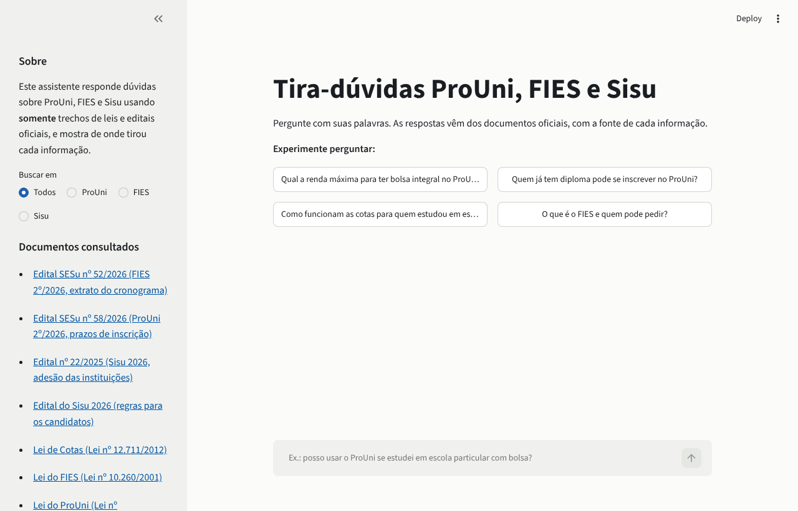

# Tira-dúvidas ProUni, FIES e Sisu (assistente de IA com RAG)

Chatbot gratuito que responde dúvidas de estudantes sobre **ProUni, FIES e Sisu** usando **somente** trechos de leis e editais oficiais, e mostra de onde tirou cada informação.

**Acesse:** https://tira-duvidas-prouni.streamlit.app/



---

## Por que este projeto existe

Todo ano, milhões de estudantes tentam entender regras de renda, documentos e prazos dos programas de acesso ao ensino superior. A informação oficial está espalhada em leis e editais longos, escritos em linguagem jurídica. Chatbots genéricos respondem com confiança, mas às vezes inventam regras ou usam as de anos anteriores.

Este assistente usa a técnica **RAG (Retrieval-Augmented Generation)**:

1. **Recupera** os trechos dos documentos oficiais mais ligados à pergunta.
2. **Gera** a resposta com um modelo de linguagem (Google Gemini), proibido de usar qualquer coisa além desses trechos.
3. **Mostra as fontes**: cada informação vem com o número do trecho, e o estudante pode abrir o documento original.

---

## Como funciona

```text
                       ┌──────────────────────────── indexar.py (uma vez) ───┐
 documentos/           │ lê PDF e HTML, remove trechos revogados,            │
 (leis e editais) ───► │ divide em trechos de ~1.200 caracteres              │──► indice/trechos.json
                       └─────────────────────────────────────────────────────┘

 pergunta do estudante
        │
        ▼
 BM25 (rag/busca.py): os 6 trechos mais relevantes
        │
        ▼
 prompt = instruções + trechos numerados + pergunta (rag/gerador.py)
        │
        ▼
 Gemini 3.5 Flash-Lite ──► resposta em português simples, com [1], [2]...
        │
        ▼
 interface Streamlit (app.py): resposta + trechos usados + links oficiais
```

### Decisões técnicas

| Decisão | Por quê |
| --- | --- |
| **BM25 em vez de banco vetorial** | Os documentos são poucos e cheios de termos exatos ("renda per capita", "bolsa parcial"). A busca por palavras acerta bem, roda localmente, é gratuita e não gasta cota de API. Expansão de sinônimos cobre o jeito como o estudante escreve ("faculdade" → "educação superior"). |
| **Trechos revogados são removidos** | No site do Planalto, a lei mostra o texto antigo riscado. O indexador apaga esse texto para o assistente não citar regras que não valem mais. |
| **Temperatura 0,2** | Queremos fidelidade ao texto, não criatividade. |
| **Citação obrigatória** | O estudante pode conferir cada afirmação no documento original. |
| **Avaliação offline** | `avaliar.py` mede se a busca encontra o trecho certo para 10 perguntas de referência, sem gastar API. |
| **Privacidade** | A interface avisa para não digitar dados pessoais, e o modelo é instruído a nunca pedir esses dados. |

---

## Rodar no seu computador

Pré-requisitos: Python 3.10+ e uma chave gratuita do Gemini.

```bash
git clone https://github.com/pdroozi/assistente-ia-prouni.git
cd assistente-ia-prouni
pip install -r requirements.txt
```

1. Crie a chave em [aistudio.google.com/apikey](https://aistudio.google.com/apikey) (gratuita, com conta Google).
2. Copie `.streamlit/secrets.toml.example` para `.streamlit/secrets.toml` e cole a chave.
3. Rode:

```bash
streamlit run app.py
```

### Atualizar os documentos (novo edital)

1. Coloque o PDF ou HTML em `documentos/`.
2. Adicione uma linha em `fontes.csv` com o nome do arquivo, o título, o programa (ProUni, FIES ou Sisu) e o link oficial.
3. Rode `python indexar.py` e depois `python avaliar.py`, para conferir se a busca continua acertando.

### Publicar de graça (Streamlit Community Cloud)

1. Suba o repositório no GitHub.
2. Em [share.streamlit.io](https://share.streamlit.io), clique em **Create app**, escolha o repositório e o arquivo `app.py`.
3. Em **Advanced settings → Secrets**, cole `GEMINI_API_KEY = "sua-chave"`.
4. Clique em **Deploy**. Em poucos minutos o assistente ganha um link público.

---

## Avaliação da busca

O índice atual tem **198 trechos** de 7 documentos oficiais: as leis do ProUni, do FIES e de Cotas (sem o texto revogado) e os editais do ProUni, do FIES e do Sisu. A busca encontra o trecho com a resposta certa entre os 6 enviados ao modelo em **10 de 10** perguntas de referência (`python avaliar.py`):

| Pergunta de referência | Trecho certo na posição |
| --- | --- |
| Qual a renda máxima para ganhar bolsa integral no ProUni? | 1 |
| Até quanto de renda posso ter para conseguir bolsa parcial de 50%? | 1 |
| Quem já tem diploma de faculdade pode se inscrever no ProUni? | 2 |
| Estudei em escola particular com bolsa integral, posso concorrer ao ProUni? | 1 |
| Professor da rede pública precisa comprovar renda no ProUni? | 1 |
| O que é o FIES e quem pode pedir o financiamento? | 1 |
| Como funciona a reserva de vagas para estudantes de escola pública? | 1 |
| O Sisu usa a nota de qual exame? | 1 |
| Posso me inscrever em mais de um curso no Sisu? | 1 |
| Pessoa com deficiência tem bolsa reservada no ProUni? | 1 |

Dois problemas reais apareceram na preparação dos documentos e foram resolvidos no código:

- **Codificação:** as páginas do Planalto estão em Windows-1252 e não declaram isso. O leitor tenta UTF-8 e, se falhar, usa Windows-1252.
- **Ligaturas em PDF:** os PDFs gerados pelo sistema SEI do governo trocam "ti" por "<" na extração ("sele<vo"). O leitor corrige isso, e "seletivo" volta a ser encontrado pela busca.

---

## Estrutura

```text
assistente-ia-prouni/
├── app.py                 # interface de chat (Streamlit)
├── indexar.py             # documentos -> indice/trechos.json
├── avaliar.py             # mede o acerto da busca nas perguntas de referência
├── rag/
│   ├── documentos.py      # leitura de PDF/HTML, limpeza e divisão em trechos
│   ├── busca.py           # BM25 com normalização para o português
│   └── gerador.py         # prompt e chamada ao Gemini
├── documentos/            # leis e editais oficiais
├── fontes.csv             # título, programa e link oficial de cada documento
├── indice/trechos.json    # índice gerado
└── avaliacao/perguntas.json
```

## Limitações

- O assistente só sabe o que está nos documentos indexados. Regras de um edital novo só entram depois de reindexar.
- Prazos e datas mudam a cada edição: confirme sempre no edital vigente e no site oficial do programa.
- **Não é um canal oficial do MEC.** É uma ferramenta de orientação feita por estudante, para estudantes.
- No plano gratuito da API do Gemini, o Google pode usar as perguntas para melhorar seus produtos; por isso o aviso para não digitar dados pessoais.

## Licença

Código sob licença MIT. Os documentos em `documentos/` são atos oficiais de domínio público.
